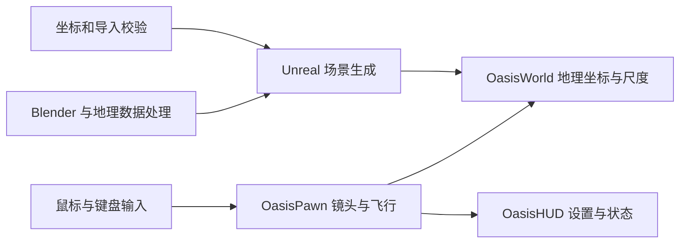

# OASIS 绿洲核心源码

OASIS 是一个运行于 Apple Silicon Mac 的空间交互原型，探索从地球逐步进入中国、上海和陆家嘴的连续体验。本仓库展示 Native v1 的核心源码、场景生成方法和验证边界。

当前实现包括地理尺度切换、镜头飞行与中断、环绕和缩放、Mac 原生输入、设置保存，以及黑白灰建筑场景。项目采用 AI 辅助开发；产品目标、范围、取舍和验收由人提出并审核，代码实现和调试由编码工具辅助完成。个人贡献的具体求职表述仍需单独核实。

## 核心实现

| 位置 | 内容 |
| --- | --- |
| [project/Source/OasisNative/OasisPawn.cpp](project/Source/OasisNative/OasisPawn.cpp) | 地理尺度飞行、镜头插值、交互中断、视角与设置持久化 |
| [project/Source/OasisNative/OasisWorld.cpp](project/Source/OasisNative/OasisWorld.cpp) | WGS84 与 Unreal 坐标转换、椭球拾取、地理轮廓与场景尺度管理 |
| [project/Source/OasisNative/OasisMacPointer.mm](project/Source/OasisNative/OasisMacPointer.mm) | Mac 指针事件与窗口输入适配 |
| [project/Source/OasisNative/OasisHUD.cpp](project/Source/OasisNative/OasisHUD.cpp) | 导航、设置和状态界面 |
| [tools/ue_build_scene.py](tools/ue_build_scene.py) | 使用已校验的几何数据生成材质、导入资产和布置场景 |
| [tools/ue_axis_gate.py](tools/ue_axis_gate.py) | 米与厘米、坐标轴和经纬度往返转换的校验方法 |
| [tools/build_lujiazui.py](tools/build_lujiazui.py) | Blender 建筑几何与环境生成方法 |
| [tools/oasis_outline.hlsl](tools/oasis_outline.hlsl) | 建筑轮廓的后处理 shader |

## 范围和运行条件

既有工程使用 Unreal Engine 5.8、Cesium for Unreal 2.30.0 和 Blender 5.2.2；这些是原工程的版本记录。本仓库仅包含源码核心，没有 Unreal Engine、Cesium 插件、Blender 原件、地图数据、FBX、Unreal Content、已打包 App 和视频，不能直接作为完整可运行发行包。原工程及资产仍保留在本机，未因导出而移动或删除。

阅读代码可直接从上述入口开始。恢复运行需要自行准备对应依赖、地理数据和场景资产，并调整本机路径、重建和验证；本仓库未提供一键安装或成功构建保证。源码中的日志和外部数据依赖见 [架构说明](docs/ARCHITECTURE.md)。

## 证据与限制

原工程保存了 2026-10-05 的坐标校验、打包运行、场景性能和视频检查记录。2026-10-16 本次导出只核查文件、语法、配置和快照完整性，没有重新构建或验收运行体验。摘要及原始记录 SHA256 见 [验证说明](docs/VERIFICATION.md) 与 [历史证据摘要](docs/evidence/HISTORICAL_CHECKS.json)。

原项目仍等待用户的视觉和交互验收。此原型不包含居民社会、意识、完整生命或交通模拟、多人系统和权利 Backend，也没有真实用户规模或商业效果指标。

地理轮廓与道路来源涉及 Natural Earth 和 OpenStreetMap contributors；建筑形态与高度含重建估计。第三方数据、插件、引擎与资产不随本快照分发，其使用仍遵循各自条款。本仓库没有授予第三方组件的再许可。

