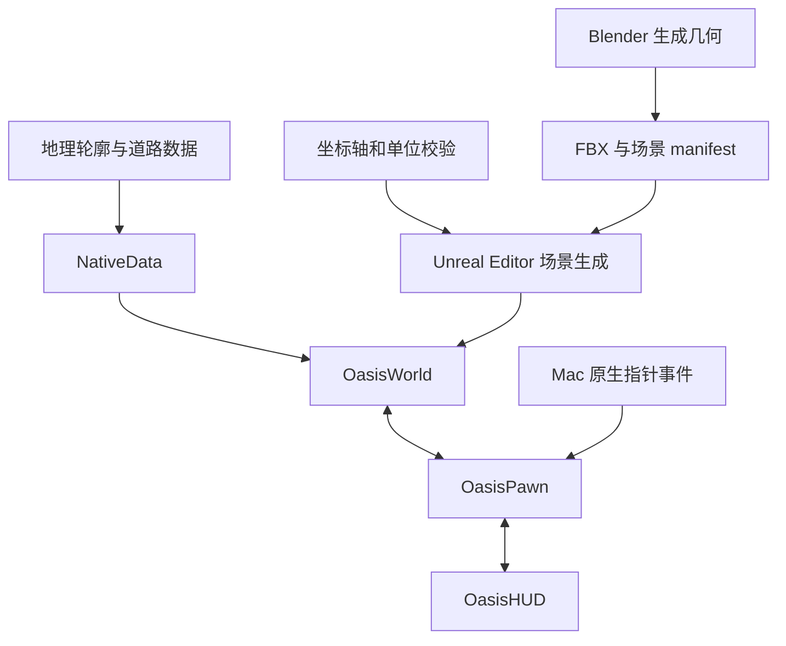

# OASIS 核心架构

## 数据到场景

`build_lujiazui.py` 在 Blender 中生成几何；`build_import_package.py` 与 `export_native_environment.py` 支持导出处理。它们依赖原工程的资产根目录与 manifest，这些大型输入未随源码快照分发。

`ue_axis_gate.py` 在 Unreal Editor 内校验 1 米对应 100 厘米、ENU 坐标轴方向和经纬度往返转换。`ue_build_scene.py` 读取通过校验的结果，再生成材质、导入 FBX 和布置场景。`oasis_outline.hlsl` 用于轮廓后处理。

`prepare_native_data.py` 将既有公开地理来源整理到 `project/Content/NativeData`。快照不携带这些来源和生成数据，运行前需自行准备，并处理对应署名与许可要求。

## 场景到交互

`OasisWorld` 负责地理坐标转换、椭球拾取、轮廓载入和显示尺度。`OasisPawn` 管理镜头位置、目标、飞行插值、中断、环绕、缩放与设置保存。`OasisMacPointer` 提供 Mac 输入适配，`OasisHUD` 绘制导航和设置。

地理中心为陆家嘴公开地标位置 WGS84 `[121.501909, 31.2364814]`，目标半径 1,000 米，原场景背景范围 1,250 米。建筑重建估计不构成测绘精度。

## 依赖和构建边界

源码包含 `.uproject`、C++/Objective-C++ 模块和基础 Config。`Config/DefaultEngine.ini` 的导出版本移除了开发服务凭据段；原本机配置未更改。

`native_build_paths.py` 支持原同一台 Mac 的构建位置校验。`build_native_editor.py` 和 `build_native_game.py` 是原工程脚本，需要引擎、插件、资产和本地构建记录。没有完整依赖时不能据此声称可构建。

本快照不包括原项目的治理草案、私人 Page、后台研究和 worker 运行状态。Native 空间交互与未来社会设计是不同阶段。

